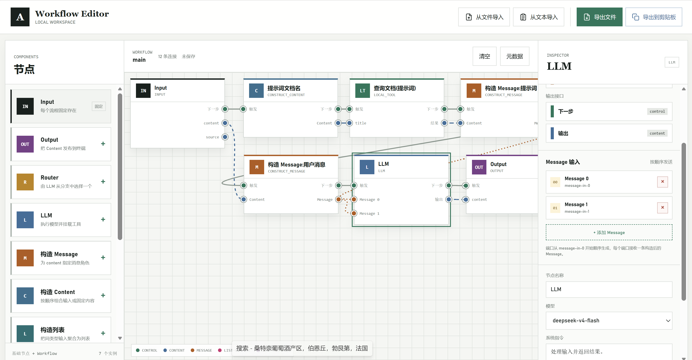
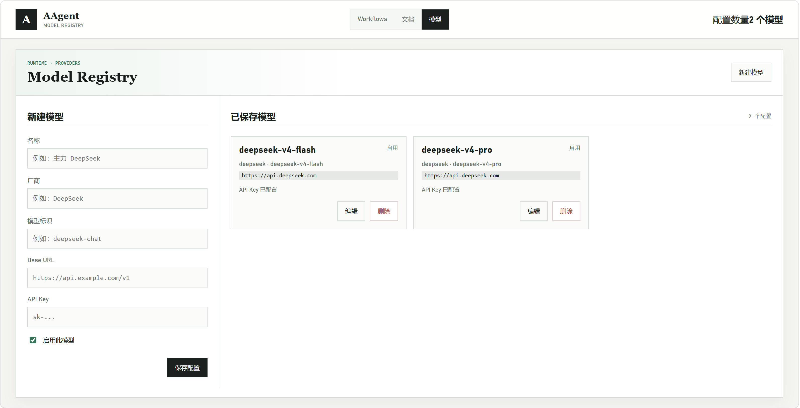
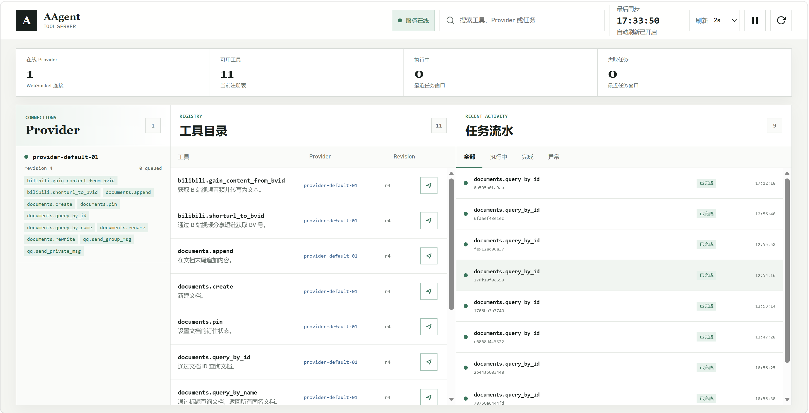
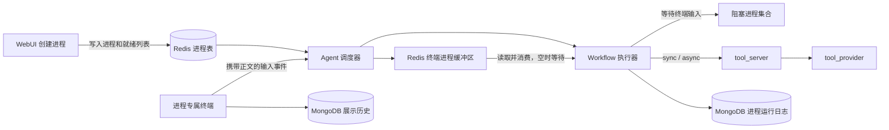

# AAgent
用OS的思路做Workflow调度。内核隔离!


高可塑性且具备工业级弹性优化(对mcp进行了魔改)的智能体"平台",希望通过这个框架对多个技术进行探索,比如(功能分化的)multiagents支持不同于以往的一问一答交互模式而是由事件驱动架构启发的长程(reAct)与瞬时任务合理调度的零等待自由交互,以及workflow的可塑性支持Agent自演进的探索,未来我也期待从数学的角度探索mcts的规划、上下文压缩、马尔科夫链决策等与llm的结合。  

目前思路(暂时):Agent中的部分操作是模式化可以通过规则(workflow)及其执行器来实现的,而不需要占用宝贵的llm throughput。进一步的,我把Agent建模为大部分的规则操作加上少部分的关键判断。

## 产品介绍

以 **进程调度与 Workflow 画布**为中心的个人 Agent 平台。用户通过 WebUI 创建工作流进程；Agent 调度器从 Redis 就绪列表读取可运行进程，并逐节点执行。Workflow 通过分布式 Tool Server 调用本地或远程工具。

每个工作流进程创建时都会分配独立的终端进程。终端消息历史按终端 ID 保存在 MongoDB，供 WebUI 展示；内核在各终端进程的 Redis 状态中独立缓冲未消费输入。进程记录和就绪/阻塞状态也保存在 Redis。

工作区文件支持独立的运行权限和访问权限；Workflow 进程从所执行的文件取得读写等级，新建文件继承创建进程的等级。配置与继承规则见 [进程与文件权限](docs/process-permissions.md)。

固定的引导、任务主流程和经验迭代器示例，以及权限初始化安装脚本，见 [固定工作流与经验迭代](docs/examples/restricted-agent/README.md)。

设计上强调:

- **可扩展** — 进程输入、Workflow 节点与 Tool Provider 分别沿调度、编排和能力三个方向扩展。
- **弹性** — Agent、Tool Server、Provider、WebUI 都是独立进程与容器,可以单独重启或替换实现。
- **灵活编排** — Workflow 不是固定的线性流水线:路由、循环、可变 Context、工具调用和子进程 Workflow 文件可以组合成复杂控制流,包括 ReAct 风格的“思考 → 行动 → 观察 → 再思考”。
- **可自定义** — 业务能力由画布编排,节点、端口和状态都显式可见;多数流程变化不需要修改执行器代码。
- **易于调试** — WebUI 可按进程查看终端消息和工作流运行日志。

> 项目仍在过渡期,架构持续调整中。设计与实现冲突时以源码为准;`docs/废弃旧文档/` 里的方案已不代表当前行为。

## 界面一览

### Workflow 编辑器

画布即契约:节点端口是强类型的,类型不匹配的连接在编辑器里就画不出来。左边是 LLM 节点拼出的最小流程,右边是带 Context、Remote Sync Tool 和 foreach 的复杂编排。

| 基础流程 | Context + 远程工具 + 循环 |
| --- | --- |
|  |  |

### 为什么是 Workflow

这里的 Workflow 不只是把几个 API 串起来,而是 Agent 的控制流语言。Router 可以按运行结果选择路径,foreach 可以展开任务,Context 可以跨节点积累状态,控制流可以成环,子进程 Workflow 文件可以把一段能力封装后再次组合。节点之间的连接同时表达执行顺序和数据依赖,因此复杂行为仍然可以被追踪、替换和复用。

这些能力可以组合出不少巧妙的模式:

- **ReAct** — 在 Workflow 内使用 while_pop、Context、LLM 和工具节点执行多轮推理，停止条件由业务结果和显式控制流决定。
- **动态计划** — 根据中间结果选择、跳过或重复步骤,而不是在代码里写死一条执行路径。
- **能力组合** — 把不同工具和子进程 Workflow 文件作为独立能力单元,按任务动态选择和编排。
- **Multi-Agent** — 未来可以把不同角色建模为可复用的 Agent Workflow,通过事件、共享 Context 和拉起并等待子进程完成委派、协作、复核与交叉验证。比如与用户对接和长任务的分工。

更重要的是,事件源和 Workflow 解耦后,一次长任务不必表现为“发出请求,等待最终答案”。未来可以把计划变化、阶段结果、工具进度、Agent 间交接和需要用户决策的节点持续转化为事件,让 Terminal、聊天平台或其他客户端呈现可追踪、可介入、可继续的交互过程。这是 AAgent 希望探索的体验:复杂执行发生在后台,但用户始终看得见进度,并能在恰当的时机参与。

### 运行与调试

终端消息保存在 MongoDB 的 `terminal_messages` 集合（可通过 `MONGO_TERMINAL_COLLECTION` 配置），并按进程终端隔离。用户输入保存历史后，通过携带正文的终端事件进入内核，再追加到当前活跃终端进程的 Redis `input_queue`。`read_terminal_queue` 按顺序消费全部未读消息，队列为空时挂起，唤醒后重试读取；消费和工作流进度原子提交。Workflow 执行 `output_to_terminal` 节点时，将 Agent 输出追加到对应终端。

ALFWorld 等外部适配器可以通过现有终端 HTTP 接口写入观察并按游标读取 Workflow 输出。终端输入已移除 4000 字符限制，请求体上限为 1 MiB；接口说明见 [终端 HTTP IO 接口](docs/terminal-io.md)。ALFWorld 评测已拆成 `benchmark_worker` 与 `benchmark_webui`，支持网页发布、Redis 分发、MongoDB 轨迹与结果可视化；启动和使用见 [Benchmark 控制台](benchmark_webui/README.md)，终端协议见 [ALFWorld 执行器](alfworld_runner/README.md)。

`webui_py` 的 `/logs` 页面按进程展示日志，数据来自 MongoDB 的 `process_logs` 集合（可通过 `MONGO_PROCESS_LOG_COLLECTION` 配置）。每个工作流进程和终端进程都有独立记录，可查看进程 ID、父子关系、当前状态、节点轨迹和进程事件。挂起与唤醒事件包含发生时间、等待原因及关联进程 ID，涵盖终端消息和子进程退出；页面支持按状态、进程类型和关键词筛选。新增事件从更新后的运行时开始记录，旧记录不会补造历史事件。

调度可视化位于 `/scheduler`（顶部「调度」导航），支持最近 5 分钟至 24 小时和不超过 7 天的自定义时间范围。甘特图按进程展示就绪、执行、挂起及等待输入区间，结束状态用菱形标记；当前进程表独立于历史时间范围，展示所有活跃进程的状态、父进程、等待对象、累计执行时间和快照时间，可按类型、状态或关键词筛选，默认每 2 秒刷新，顶部导航栏提供最后同步时间、刷新间隔、暂停／继续和立即刷新按钮。点击进程后，右侧区域自动切换到「进程详情」标签，显示关系与调度事件；历史事件以列表按时间排列，展示中文事件名称、状态、等待对象及错误信息；可随时切回「当前进程表」，筛选和分表选择会保留。页面占满视口，时间线、进程表和进程详情在各自面板内滚动；窄屏上下排列时也按剩余高度分配空间。

调度页通过只读 `GET /api/scheduler` 接口读取公开 Redis 的当前状态与 MongoDB 的历史事件，不访问 Redis 内核库。页面可分别查看全部活跃进程、就绪队列、运行表、阻塞表和等待输入表；就绪队列按下一次执行的顺序排列并标出位置。历史窗口最多加载 500 条记录，当前表最多显示 1000 条，超过时页面明确提示，概览计数仍覆盖全部活跃进程。任一数据源故障时，另一部分仍可显示。运行时新增逐节点的 `resumed`（再次调度）和 `yielded`（返回就绪）事件，并为快照写入 `observed_at`；WebUI 与 Agent 应一起重新构建。旧记录缺少逐次调度事件时仅展示已有生命周期区间并标注精度限制，不把整段生命周期当成实际执行占用。快照时间表示最近一次状态同步时间，进程长时间等待时不会持续更新。

Agent 在创建、调度、挂起、唤醒、结束及取消进程的事务中，单向同步公开进程投影和索引；公开投影只含 ID、关系、状态、等待对象和计时字段，不发布 Workflow 执行图、Context、输入输出或事件正文。同步与内核提交复用同一个 Redis 实例的跨库事务，取消后的迟到提交不会重新发布旧状态，连接在事务结束前恢复内核库。启动时从内核重建公开投影，清理残留记录并保留就绪队列顺序。运行时不会读取公开投影来决定调度。

公开键前缀由 Agent 与 WebUI 共用的 `PUBLIC_SCHEDULER_PREFIX` 配置，默认为 `aagent:scheduler`：

| 公开键后缀 | 类型 | 内容 |
| --- | --- | --- |
| `:processes` | Hash | 进程 ID → 精简状态 JSON，含已结束进程的最后状态 |
| `:ready` | List | 就绪队列，沿用 LPUSH/RPOP，API 返回顺序为下一次执行在前 |
| `:running` | Set | 正在执行的进程 ID |
| `:blocked` | Set | 挂起进程 ID |
| `:waiting_for_input` | Set | 等待输入的终端进程 ID |
| `:meta` | Hash | 投影初始化时间与最近提交时间；不是运行时心跳 |


### 管理

管理 WebUI 提供 Sessions、文档和 LLM 模型注册表管理。Workflow 文件在工作区中管理，并通过 Workflow 编辑器设计和导出。



### Tool Server

Provider 在线状态、工具目录和任务流水都在这里看。



Tool Server 的详细介绍、接口配置与调用示例、完整功能演示图,见 [`tool_server/README.md`](tool_server/README.md)。

## 架构



- **进程表** 保存在 Redis；就绪进程由调度器逐个取出执行，阻塞进程等待其 wait_for 指定的进程结束或终端消息。
- **终端** 是进程专属的被动进程。创建工作流进程时同时创建终端；用户从 WebUI 选择终端后可发送和查看消息。消息正文由内核保存到终端进程缓冲区，并自动唤醒正在等待该终端的工作流。提前输入会保留到读取节点执行，父子终端进程的缓冲区独立。
- **Workflow** 在进程上下文内执行，output_to_terminal 将输出写入当前进程关联的终端。
- **tool_server** 管理工具注册、调用和异步任务状态。它的独立回调 outbox 不属于 Agent 进程调度队列。

## 服务与端口

| 服务 | 端口 | 说明 |
| --- | --- | --- |
| `webui_py` | 8081 | Agent WebUI:进程终端、进程创建、工作区与运行日志 |
| `workflow_editor` | 8082 | Workflow 可视化编辑器(独立服务,只导出 JSON) |
| `tool_server` | 8083 | 工具注册、调用、任务状态与控制台 |
| `manager_webui` | 8084 | 管理 WebUI:Sessions、文档、模型 |
| `agent` | — | Redis 进程调度器与工作流执行器 |
| `tool_provider` | — | 工具实际执行方,通过 WebSocket 注册到 Tool Server |
| `redis` / `mongodb` | — | 队列与存储,仅在 dev 配置下暴露到宿主机 |

## 快速启动

1. 安装 Docker Desktop 与 Docker Compose;
2. 复制环境变量模板并填写当前启用服务所需的配置;
3. 构建并启动服务。

进程由 Agent WebUI 创建；每个进程拥有独立终端，无需配置全局终端或事件绑定。

```powershell
Copy-Item .env.example .env
# 编辑 .env
docker compose up --build -d
docker compose logs -f agent webui_py
```

启动后 Agent WebUI 在 `http://localhost:8081`,管理 WebUI 在 `http://localhost:8084`。

在 Agent WebUI 工作区保存 Workflow 2.0 文件后，打开终端页创建进程并选择该工作流。创建请求直接携带 workflow_file_id 和输入值；调度器从 Redis 就绪列表执行进程。`spawn_and_wait_subprocess` 节点从 `workflow-file` 和 `arguments-json` 输入接收精确工作区文件名与 JSON 参数，等待子进程退出后从 `result-json` 返回 JSON 对象；无需声明子 Workflow metadata。连接可选的 `error-out` 分支后，子进程失败或终止会唤醒父进程并通过 `error-json` 返回错误内容；参数 JSON 无效、参数不符合子流程接口、目标 Workflow 文件不存在等调用前错误也进入同一分支，此时 `process_id` 为 `null`，不会创建子进程；未连接时继续传播失败。

工作区 checkpoint API 同时注册为 Local Tool，可在工具目录中选择：

| 工具名 | 参数 | 用途 |
| --- | --- | --- |
| `workspace.list_checkpoints` | `before_seq?`、`limit?`（默认 50，范围 1–100）、`file_id?` | 分页列表，返回 `items`、`has_more`、`next_before_seq` |
| `workspace.checkpoint_tree` | 无 | 分支树和当前 `head_seq` |
| `workspace.get_parent_checkpoint` | `seq?`（默认当前 head） | 返回 `seq` 和 `parent_seq`，按分支祖先查询回滚目标 |
| `workspace.checkpoint_diff` | `seq` | 相对于父 checkpoint 的文件差异 |
| `workspace.get_file_recovery_plan` | `file_id`、`stable_file_id`、`checkpoint_seq` | 只读查询当前分支上的不同文件旧版本，以 stable 为底线，返回有序恢复候选 |
| `workspace.create_checkpoint` | `name` | 保存当前工作区快照 |
| `workspace.restore_checkpoint` | `seq` | 恢复整个工作区并更新文件 revision |

`seq=0` 表示空工作区，恢复到 0 会清空工作区文件。工具复用 `WORKSPACE_API_URL`（默认 `http://webui_py:8081`）访问现有 API。

回滚一步：先调用 `workspace.get_parent_checkpoint`（参数 `{}`），再将返回的 `parent_seq` 作为 `workspace.restore_checkpoint` 的 `seq`。第一个 checkpoint 的 `parent_seq` 为 `0`，可恢复为空工作区；当前已为空工作区时返回 `parent_seq: null`，此时没有更早的回滚目标。父序号按分支关系确定，恢复后再次查询使用新的当前 head。

### 环境变量

`.env.example` 已按用途分组:

| 分组 | 变量 |
| --- | --- |
| LLM | `DEEPSEEK_*`、`KIMI_*`、`ZAI_API_KEY`、`TAVILY_API_KEYS`、`BOCHA_*` |
| 工具 Provider | QQ_API_BASE_URL、QQ_API_TOKEN（供 QQ 工具调用） |
| 进程调度 | REDIS_*、AGENT_TOOLS_KEY、ProcessTable、ReadyProcesses、BlockedProcesses |
| Tool | `TOOL_SERVER_URL`、`TOOL_MAX_WAIT_MS`、`TOOL_CLIENT_*`、`TOOL_PROVIDER_*`、`TOOL_MODULES` |
| 存储 | `MONGO_*` 及各集合名 |

Redis 使用两个独立数字库，两个编号必须不同：

| 配置 | 默认库 | 数据 |
| --- | --- | --- |
| `REDIS_DB` | 0 | 公共事件队列 `external_events`、终端状态 `terminal_sessions`、工具注册及工具服务数据 |
| `REDIS_KERNEL_DB` | 1 | runtime 进程表、ready / blocked、内部终端索引、Workflow Context |

WebUI 等服务只连接公共库，只有 agent 连接内核库。Agent 将精简进程状态及调度索引单向发布到公共库，供调度可视化读取。调度器非阻塞读取内核 ready 队列，每执行一个节点后处理公共库的外部事件；ready 为空时阻塞等待外部事件。当前按单个 runtime 调度循环运行。变更库编号后不自动迁移旧库中的运行状态。

## 开发调试

`docker-compose.dev.yml` 挂载宿主机源码,并让 `agent` 以 `sleep infinity` 启动,改完代码不用重建镜像,手动跑入口即可:

```powershell
docker compose -f docker-compose.yml -f docker-compose.dev.yml up -d --build
docker compose exec agent python main.py
```

发布时不要叠加这个文件。

注意:生产配置 `docker-compose.yml` 里只有 `redis` / `mongodb` 有 volumes,`webui_py` / `manager_webui` / `workflow_editor` / `tool_server` 的代码都在镜像内,改完要 `docker compose up -d --build <服务>`;dev 配置下这四个服务已挂载源码目录,但静态资源引用形式是 `?v=N`,改动后仍需递增版本号才会绕过浏览器缓存。

## 目录结构

```
agent/              Agent 运行时:Workflow 校验、解析、执行与节点实现
tool_server/        工具注册与调用中心,任务状态、回调投递
tool_provider/      实际执行工具的 Provider(QQ / Bilibili / 文档)
webui_py/           Agent WebUI(8081)
manager_webui/      管理 WebUI(8084)
benchmark_webui/    评测控制台(8085)
benchmark_worker/   ALFWorld 评测 worker
benchmark_common/   任务配置与 Redis/MongoDB 存储
workflow_editor/    Workflow 编辑器(8082)
docs/               设计文档、审查记录与 README 图片
data/               Redis / MongoDB 持久化数据(不提交)
```
